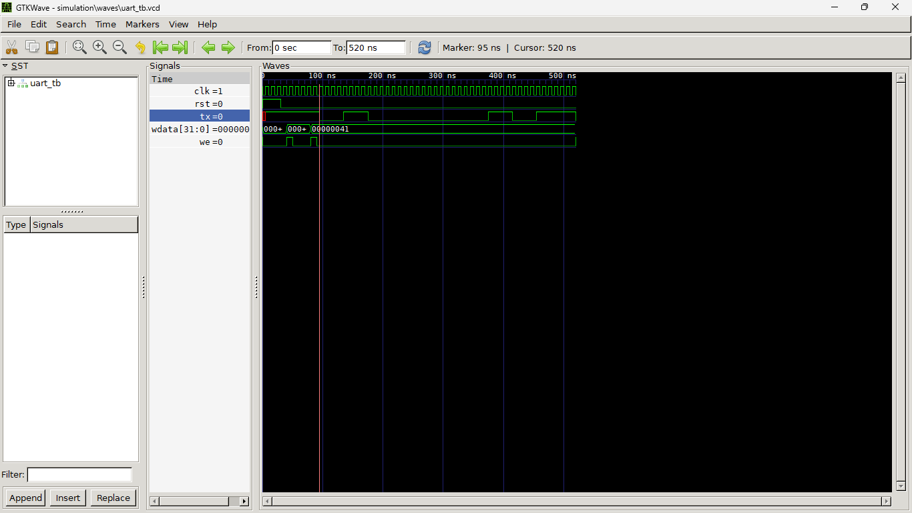
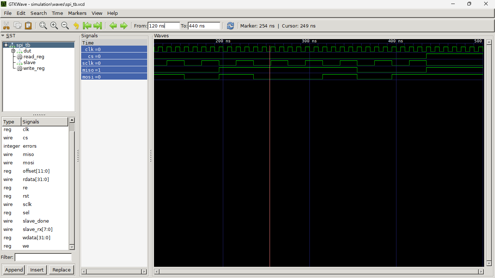
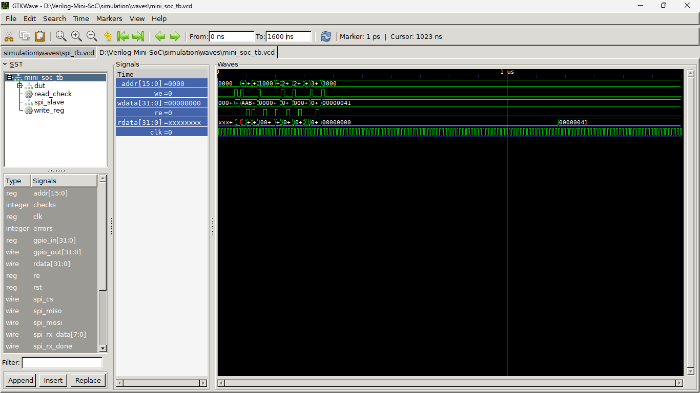

# Verilog 32-bit Mini SoC

[](https://github.com/kishorak-git/verilog-mini-soc/actions/workflows/verilog-regression.yml)
[](https://github.com/kishorak-git/verilog-mini-soc/actions/workflows/ci.yml)


## Project overview

A simulation-based 32-bit Mini System-on-Chip (SoC) implemented in Verilog. The design integrates a shared memory-mapped bus, RAM, GPIO, timer, UART, and SPI master. It is compiled and verified with Icarus Verilog and automated testbenches, with Windows and Linux CI workflows.

**Scope:** This is an RTL design and simulation project. It does not contain a CPU and has not been presented as a physical FPGA implementation or hardware-tested system.

## Architecture

The top-level module is `mini_soc`. Address bits `[15:12]` select a RAM or peripheral region, while `[11:0]` provide the local offset. The shared interface uses `sel`, explicit read strobe `re`, write strobe `we`, 32-bit `wdata`, and 32-bit `rdata`. Unmapped address regions return zero.

| Region | Address range | Function |
|---|---|---|
| RAM | `0x0000–0x0FFF` | 4 KB memory-mapped RAM |
| GPIO | `0x1000–0x1FFF` | Input capture and output control |
| Timer | `0x2000–0x2FFF` | Configurable counter and period |
| UART | `0x3000–0x3FFF` | Serial transmit/receive and status |
| SPI | `0x4000–0x4FFF` | SPI master data, control and status |
| Unmapped | `0x5000` and above | Zero read response |

See [docs/architecture.md](docs/architecture.md) for the block diagram, bus behavior, peripheral register maps, UART synchronization, status handling, data flow, and reset behavior.

## Main features

- Shared 32-bit read-data bus and memory-mapped address decoder.
- 4 KB RAM, GPIO, timer, UART, and SPI master.
- UART RX synchronization and framing-error handling.
- Sticky bus-visible UART and SPI status flags.
- Invalid-address read response of zero.
- Standalone peripheral testbenches and full Mini SoC integration testbench.
- PowerShell scripts for Windows compilation and regression.
- Linux regression and generic Yosys synthesis through GitHub Actions.

## Verification

The latest documented local Windows regression contains **48 checks with 0 errors** across six suites.

| Test suite | Checks | Errors |
|---|---:|---:|
| GPIO | 3 | 0 |
| RAM | 4 | 0 |
| Timer | 3 | 0 |
| UART | 16 | 0 |
| SPI | 7 | 0 |
| Full Mini SoC | 15 | 0 |
| **Total** | **48** | **0** |

The recorded GitHub Actions runs also completed successfully:

- [Windows Icarus Verilog regression](https://github.com/kishorak-git/verilog-mini-soc/actions/runs/44997589419)
- [Linux simulation and synthesis](https://github.com/kishorak-git/verilog-mini-soc/actions/runs/44997589437)

The test coverage and interpretation are documented in [docs/verification.md](docs/verification.md). The consolidated local report is [simulation/results.txt](simulation/results.txt).

## Toolchain

- Verilog HDL
- Icarus Verilog (`iverilog`)
- VVP simulator (`vvp`)
- Windows PowerShell
- Linux shell
- Yosys for generic synthesis
- Git and GitHub Actions

## Setup

Install Icarus Verilog and ensure both `iverilog.exe` and `vvp.exe` are available on your system `PATH`. The Windows scripts resolve the executables dynamically; they do not require a fixed installation directory. For example, a Chocolatey installation can expose the commands through its shims.

Clone the repository:

```powershell
git clone https://github.com/kishorak-git/verilog-mini-soc.git
cd verilog-mini-soc
```

## Compile on Windows

```powershell
powershell.exe -NoProfile -ExecutionPolicy Bypass -File .\scripts\compile_soc.ps1
```

## Run the complete Windows regression

```powershell
powershell.exe -NoProfile -ExecutionPolicy Bypass -File .\scripts\run_all_tests.ps1
```

The script compiles and runs GPIO, RAM, timer, UART, SPI, and full Mini SoC testbenches. It generates individual logs and the consolidated report at `simulation\results.txt`.

To exercise the negative-control path separately (this is expected to return a non-zero status):

```powershell
powershell.exe -NoProfile -ExecutionPolicy Bypass -File .\scripts\run_all_tests.ps1 -NegativeControl
```

## Run on Linux

With Icarus Verilog installed:

```bash
bash scripts/run_all.sh
```

The Linux CI workflow also runs generic Yosys synthesis and uploads simulation and synthesis artifacts.

## Continuous integration

Two GitHub Actions workflows run on pushes and pull requests targeting `main`:

- **Windows:** [`.github/workflows/verilog-regression.yml`](.github/workflows/verilog-regression.yml) installs Icarus Verilog, verifies `iverilog.exe` and `vvp.exe` through PATH, compiles the top-level SoC, runs all regression suites, and uploads the consolidated report.
- **Linux:** [`.github/workflows/ci.yml`](.github/workflows/ci.yml) installs Icarus Verilog and Yosys, runs the Linux regression and synthesis, and uploads generated reports.

The badges at the top show the current status of each workflow on `main`.

## Synthesis note

The project includes a generic Yosys synthesis flow. Generic cell counts are tool-level statistics and must not be interpreted as FPGA LUT, flip-flop, DSP, or timing utilization for a particular device. The RAM implementation and synthesis assumptions are described in the synthesis reports.

## Waveforms



UART TX frame for byte 0x41 ('A'): start bit, eight data bits LSB first (1 0 0 0 0 0 1 0), stop bit. Simulated at a fast baud rate to keep regression runs short (about 40 ns per bit).



SPI master transfer (mode 0, divider 2): chip select asserts, SCLK pulses, and data shifts on MOSI and MISO.



Memory-mapped bus activity showing address, read/write controls, write data, and read data.

Waveforms are generated from the testbenches (VCD dumped to simulation\waves, not committed) and viewed in GTKWave.

## Limitations

- No CPU or instruction-set architecture is included.
- The project is simulation-based; no physical FPGA board validation is claimed.
- UART and SPI are behavioral RTL peripherals and are not claimed as production-certified IP.
- No target FPGA device, timing constraints, or board-level implementation is specified.

## Future work

- Add byte-write strobes or formalize the bus protocol.
- Extend UART parity and SPI mode configuration.
- Parameterize address maps and clock frequencies.
- Add assertion-based and constrained-random verification.
- Select a target FPGA and add device-specific synthesis, timing, and hardware validation.
