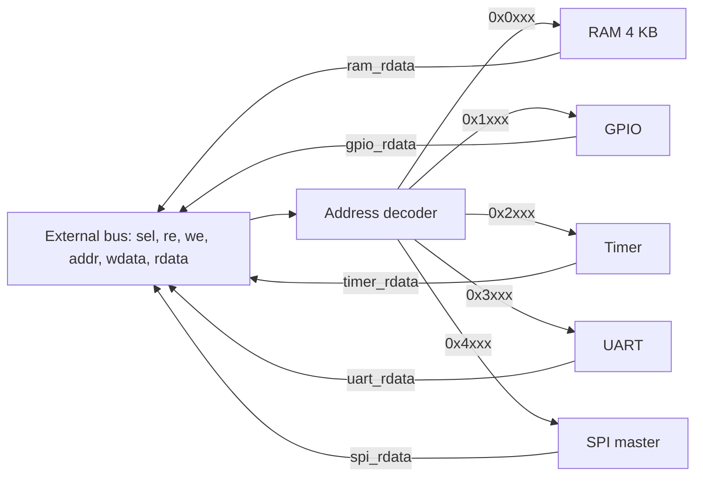

# Verilog 32-bit Mini SoC


## Project Introduction

This project implements a simulation-based 32-bit Mini System-on-Chip (SoC) in Verilog. It contains a shared memory-mapped bus, address decoder, RAM, GPIO, timer, UART, and SPI master. The project is written for Icarus Verilog and verified with behavioral testbenches. It does not contain a CPU or physical FPGA hardware implementation.

## Quick Navigation

- [Architecture](./docs/architecture.md)
- [Address and register maps](#address-map)
- [Build instructions](#compilation)
- [Simulation instructions](#simulation)
- [Verification results](#verification-results)
- [Limitations](#limitations)
- [Future roadmap](#future-roadmap)

## Problem statement and motivation

Memory-mapped bus systems are a foundation of digital SoC design. This project demonstrates bus decoding, peripheral register access, reset behavior, serial timing, and RTL verification in a small reproducible design.

## Objectives

- Preserve a consistent 16-bit bus address space and 32-bit data access model.
- Provide RAM and five memory-mapped peripheral regions.
- Exercise GPIO, timer, UART, and SPI behavior.
- Verify individual peripherals and full-system integration.
- Provide Windows-compatible, reproducible verification scripts.
- Produce documentation suitable for an academic engineering portfolio.

## Architecture

The top-level module is `mini_soc`. Address bits `[15:12]` select a RAM or peripheral region. Address bits `[11:0]` provide a 4 KB offset. Write strobe `we` and explicit read strobe `re` control register access. A valid read event is `sel && re`; invalid addresses return zero on `rdata`.

See the complete [architecture and data-flow documentation](./docs/architecture.md).



There is no CPU. The external testbench supplies the address, write-enable, read-strobe, and write-data signals.

## Main features

- Shared 32-bit read data bus.
- Word-oriented RAM with byte-address offset conversion.
- GPIO input capture and software-controlled output.
- Configurable timer period and count register.
- UART transmit and receive datapaths with a configurable baud divider.
- SPI master with configurable clock divider and shift logic.
- Sticky UART receive-ready, UART transmit-done, and SPI transfer-done status flags.
- Invalid address read response of zero.

## Address map

| Peripheral | Start | End |
|---|---:|---:|
| RAM | `0x0000` | `0x0FFF` |
| GPIO | `0x1000` | `0x1FFF` |
| Timer | `0x2000` | `0x2FFF` |
| UART | `0x3000` | `0x3FFF` |
| SPI | `0x4000` | `0x4FFF` |
| Invalid/unmapped | `0x5000` and above | zero read |

## Register map

### GPIO

| Register | Offset | Access | Description |
|---|---:|---|---|
| Output | `0x0` | Read/write | GPIO output pins |
| Input | `0x4` | Read | Captured GPIO input pins |

### Timer

| Register | Offset | Access | Description |
|---|---:|---|---|
| Control | `0x0` | Read/write | Enable in bit 0 |
| Counter | `0x4` | Read | Running counter |
| Period | `0x8` | Read/write | Counter period |

### UART

| Register | Offset | Access | Description |
|---|---:|---|---|
| Data | `0x0` | Read/write | RX data or TX start/data |
| Status | `0x4` | Read | RX Ready, TX Done, TX Busy |
| Baud divider | `0x8` | Read/write | Clocks per serial bit |

Status bits:

- Bit 3: framing error.
- Bit 2: receive ready.
- Bit 1: transmit done.
- Bit 0: transmit busy.

Receive Ready is sticky until a DATA or STATUS read. Framing Error is sticky until a STATUS read or a new framing-error event. Transmit Done is sticky until a STATUS read or a new transmission. A `re` pulse clears sticky status only while `sel` selects UART and only for the addressed register.

The UART receiver uses a two-flop RX synchronizer. The synchronized signal detects a start condition, samples data bits near the center of their bit periods, validates the stop bit, and discards invalid bytes with a framing-error indication.

### SPI

| Register | Offset | Access | Description |
|---|---:|---|---|
| Data | `0x0` | Read/write | Received data or transmit value |
| Status | `0x4` | Read | Transfer Done, Busy |
| Control | `0x8` | Read/write | Starting bit 0 |
| Divider | `0xC` | Read/write | SPI clock divider |

Status bits:

- Bit 1: transfer done.
- Bit 0: transfer busy.

Transfer Done is sticky until a STATUS read or a new transfer starts.

## Technology stack

- Verilog HDL
- Icarus Verilog
- VVP simulator
- Windows PowerShell 5.1
- Git/GitHub

## Directory structure

```text
.github/workflows/ GitHub Actions CI workflow
rtl/          Synthesizable RTL modules
testbench/    Standalone and full-system testbenches
scripts/      PowerShell compile and regression scripts
simulation/   Verified logs and generated Icarus binaries
docs/         Architecture documentation
docs/releases/ Release descriptions
README.md     Project documentation
```

## Installation and prerequisites

Install Icarus Verilog with `iverilog.exe` and `vvp.exe` available under `C:\iverilog\bin`, or place both on `PATH`. Windows PowerShell 5.1 is sufficient.

Clone and enter the repository:

```powershell
cd D:\Verilog-Mini-SoC
```

## Compilation

Compile the top-level Mini SoC:

```powershell
powershell.exe -NoProfile -ExecutionPolicy Bypass -File .\scripts\compile_soc.ps1
```

The script creates `simulation\mini_soc_compile.vvp` and exits with zero only if compilation succeeds.

## Simulation

Run all standalone and full-system suites:

```powershell
powershell.exe -NoProfile -ExecutionPolicy Bypass -File .\scripts\run_all_tests.ps1
```

The script compiles and runs GPIO, RAM, Timer, UART, SPI, and Full Mini SoC. It writes individual logs and the consolidated report to `simulation\`.

Individual suites can also be run with Icarus directly:

```powershell
iverilog -g2012 -s uart_tb -o simulation\uart_test.vvp rtl\uart.v testbench\uart_tb.v
vvp simulation\uart_test.vvp
```

On Linux or GitHub Ubuntu runners:

```bash
bash scripts/run_all.sh
```

The Linux runner requires an `ALL PASSED` success marker and fails on explicit `FAIL:` output or missing success markers.

To verify negative-control failure detection separately:

```powershell
powershell.exe -NoProfile -ExecutionPolicy Bypass -File .\scripts\run_all_tests.ps1 -NegativeControl
```

This mode is expected to exit non-zero and must not be used in the normal regression suite.

## Synthesis results

Generic Yosys synthesis was reproduced with Yosys 0.71:

```text
mkdir -p simulation/synthesis
yosys -s scripts/synth.ys
```

On Windows, the supporting wrapper can be used:

```powershell
powershell.exe -NoProfile -ExecutionPolicy Bypass -File .\scripts\synth.ps1
```

| Block | Generic Yosys cells |
|---|---:|
| RAM | 66,701 |
| GPIO | 177 |
| Timer | 553 |
| UART | 643 |
| SPI | 413 |
| Mini SoC total | 68,761 |

These are generic Yosys cell counts, not FPGA LUT, flip-flop, or DSP utilization figures. In this generic synthesis configuration, the 4 KB RAM is implemented with 32,768 flip-flops and is approximately 97% of the top-level cell count. This is an implementation limitation of generic synthesis and not a physical FPGA resource claim.

Generated reports are saved under [simulation/synthesis](./simulation/synthesis).

## Continuous integration

GitHub Actions provides both Windows and Ubuntu workflows:

- [`.github/workflows/verilog-regression.yml`](./.github/workflows/verilog-regression.yml) runs Windows Icarus compilation and the six-suite regression.
- [`.github/workflows/ci.yml`](./.github/workflows/ci.yml) runs Linux Icarus regression and Yosys synthesis.

## Verification results

The latest automated regression result is:

| Suite | Checks | Errors |
|---|---:|---:|
| GPIO | 3 | 0 |
| RAM | 4 | 0 |
| Timer | 3 | 0 |
| UART | 16 | 0 |
| SPI | 7 | 0 |
| Full Mini SoC | 15 | 0 |
| **Total** | **48** | **0** |

Actual output is retained in [simulation/results.txt](./simulation/results.txt).

## Limitations

- There is no CPU or instruction-set architecture.
- This is a simulation-only RTL project.
- UART and SPI are protocol models suitable for behavioral verification, not complete production-grade peripherals.
- No physical FPGA implementation or hardware timing validation is claimed.
- RAM initialization is not specified from an external memory image.

## Future Roadmap

- Add byte strobes or a formal 32-bit bus protocol.
- Add UART configurable parity and SPI sample-edge options.
- Add parameterized address maps and clock frequencies.
- Add constrained-random and assertion-based verification.
- Add synthesis and FPGA timing scripts only after a target board is selected.