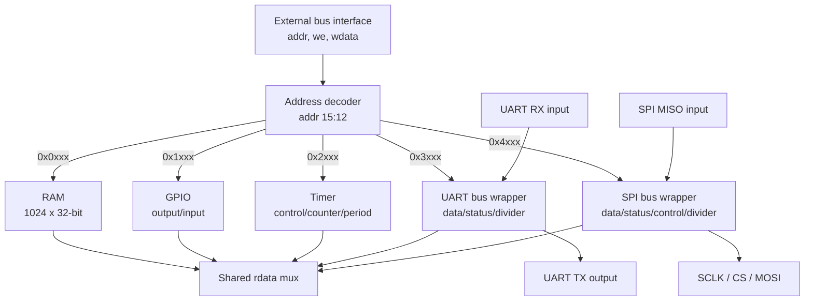
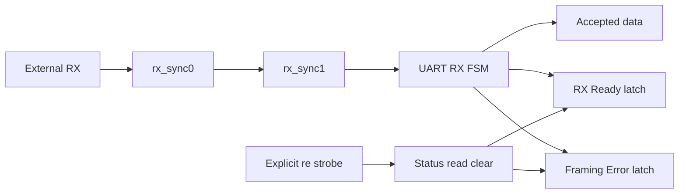

# Mini SoC Architecture

## Scope

This is a behavioral, simulation-based 32-bit Mini SoC. The design has an external shared bus and memory-mapped peripherals. It does not include a CPU or make physical hardware claims.

## Top-level architecture

The top-level module `mini_soc` instantiates one RAM module and one instance of each peripheral. Every read-data output is zero outside its selected region. The top-level multiplexes the selected peripheral response onto `rdata`.

## External shared bus

- `addr[15:12]` selects the addressed region.
- `addr[11:0]` is passed to the selected module as a register offset.
- `we` enables a synchronous write.
- `re` enables an explicit synchronous read.
- `wdata[31:0]` carries write data.
- `rdata[31:0]` carries the selected read response.
- An unmapped address region returns zero.

## Address decoder

The decoder uses address bits `[15:12]`:

| Region | Decode value |
|---|---|
| RAM | `4'h0` |
| GPIO | `4'h1` |
| Timer | `4'h2` |
| UART | `4'h3` |
| SPI | `4'h4` |
| Invalid | any other value |

## RAM

RAM is a synchronous 1024-word memory. It accepts a write when `sel` and `we` are asserted on a rising clock edge. `offset[11:2]` addresses 32-bit words, producing a 4 KB address region. Reads are combinational from the selected memory word.

## GPIO

GPIO has separate output and input registers:

| Offset | Register | Behavior |
|---|---|---|
| `0x0` | Output | Updated by bus write |
| `0x4` | Input | Captures `pin_in` each clock |

The input register is sampled on rising clock edges. Reset clears output and input registers.

## Timer

| Offset | Register | Behavior |
|---|---|---|
| `0x0` | Control | Bit 0 enables counting |
| `0x4` | Counter | Current count |
| `0x8` | Period | Wrap period |

When enabled, the counter increments until it reaches `period - 1`, then wraps to zero. A zero period disables wrapping logic and allows normal increment behavior. Disabling the timer resets its counter to zero.

## UART

The UART bus wrapper contains a transmit datapath, receive datapath, baud register, and sticky completion status.

| Offset | Register | Behavior |
|---|---|---|
| `0x0` | DATA | Writes start TX; reads return RX data |
| `0x4` | STATUS | RX Ready, TX Done, TX Busy |
| `0x8` | Baud divider | Clocks per serial bit |

Status bit mapping:

- Bit 3: framing error.
- Bit 2: receive ready.
- Bit 1: transmit done.
- Bit 0: transmit busy.

The external RX input passes through separate `rx_sync0` and `rx_sync1` sequential registers. UART FSM decisions use only `rx_sync1`. The receiver verifies a confirmed start condition, samples data near the center of each configured bit period, and validates the stop bit. Invalid stop bits discard the byte and set a sticky framing-error latch.

Internally, `rx_ready`, `tx_done`, and the framing-error event remain completion pulses. Bus-facing latches make these statuses sticky:

- RX Ready remains set until DATA or STATUS is read, or a new receive event sets it again.
- TX Done remains set until STATUS is read or a new transmission is started.
- Framing Error remains set until STATUS is read or a new framing-error event occurs.
- Completion events have priority over simultaneous status-clear or new-start actions.

## SPI

The SPI bus wrapper contains an SPI master and software-visible control, data, divider, busy, and done status.

| Offset | Register | Behavior |
|---|---|---|
| `0x0` | DATA | Writes transmit data; reads return received data |
| `0x4` | STATUS | Transfer Done and Busy |
| `0x8` | CONTROL | Bit 0 starts a transfer |
| `0xC` | DIVIDER | SPI clock divider |

Status bit mapping:

- Bit 1: transfer done.
- Bit 0: busy.

Internally, SPI `done` remains a one-clock pulse. The bus wrapper latches it so it remains set until STATUS is read or a new transfer starts. A completion pulse occurring at the same time as a new start or status clear is handled by event-versus-clear priority.

## Data flow

1. A testbench or bus master presents `addr`, `we`, `re`, and `wdata`.
2. `mini_soc` decodes `addr[15:12]` and enables exactly one peripheral.
3. The selected peripheral decodes `addr[11:0]`.
4. A write updates the target register or initiates a peripheral operation.
5. A read asserted with `sel && re` selects the appropriate register or status and returns it on `rdata`.
6. Invalid regions return zero.

UART and SPI loopback/integration behavior is evaluated by RTL testbenches and a behavioral slave model.

## Reset behavior

- GPIO: clears output and input registers.
- Timer: disables counting and clears counter and period.
- UART: sets default baud value, clears transmit state and sticky status.
- SPI: clears transmit state, divider, and status; sets CS inactive.
- RAM: does not initialize memory contents; it is not reset explicitly.
- Top-level: propagates reset to resettable peripheral modules.

## Peripheral isolation

Each peripheral receives the full address and write-enable but only enables its internal write logic when its top-level region select is active. Its read-data output is zero when deselected.